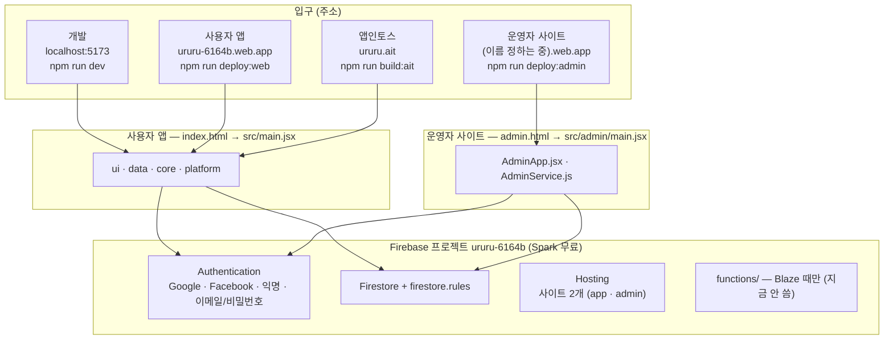
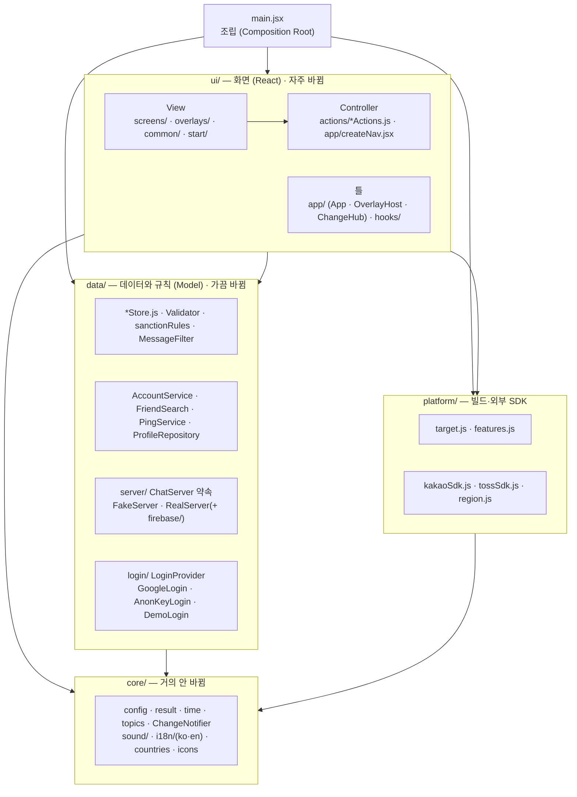
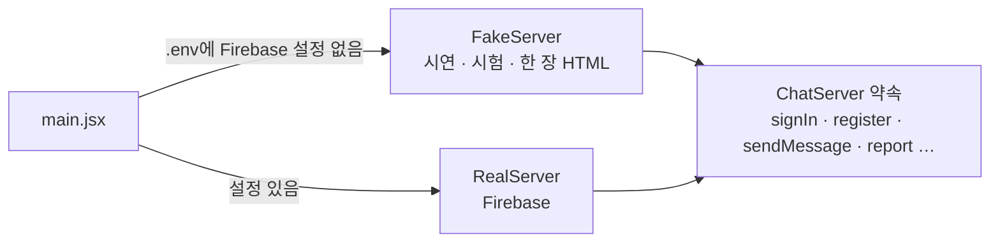
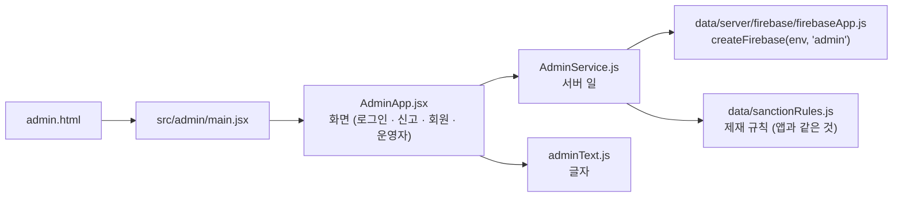

# architecture.md — 우르르 아키텍처 (구조 · 층 · 의존 · 서버)

> **AI·사람 모두 코드를 고치기 전에 이 문서를 먼저 읽어요** (`CLAUDE.md` 읽는 순서 1번).
> 무엇이 어디에 있고, 누가 누구를 쓰고, 서버와 로그인이 어떻게 붙어 있는지 한 곳에 모았어요.
> 2026-10-21 만듦 — `tech-stack.md` 3~6번(폴더·의존·React 규칙·패턴)과 `roadmap.md` 구현 현황의 그림을 여기로 옮겼어요.

| 알고 싶은 것 | 문서 |
|---|---|
| 구조 · 층 · 의존 · 서버 · 패턴 | **이 문서** |
| 쓰는 기술 버전 · 금지 기술 · 크기 규칙 · 실행 명령 | [`tech-stack.md`](tech-stack.md) |
| 파일 하나하나가 하는 일, 데이터가 흐르는 예 | [`code-structure-and-patterns.md`](code-structure-and-patterns.md) |
| 전체 파일 트리 | [`file-tree.md`](file-tree.md) |
| 코드 모양(Allman 등)과 원칙 | [`coding-rules.md`](coding-rules.md), `CLAUDE.md` 5·6번 |
| 무엇이 됐고 무엇이 남았나 | [`roadmap.md`](roadmap.md) "구현 현황" |
| **등급별 들어가는 주소** (사용자 · 운영자 · 총관리자 · 최종관리자 · 콘솔) | [`guides/admin-guide.md`](guides/admin-guide.md) 1번 |
| 운영자 등급 · 승인 흐름 | [`guides/admin-roles.md`](guides/admin-roles.md) |

---

## 1. 한눈에 — 입구 3개, 서버 1개

- **서버(데이터·로그인)는 하나**, 입구만 여러 개예요. 개발 중에 가입한 사람도 진짜 웹·운영자 사이트에서 그대로 보여요.
- 사용자와 운영자를 나누는 건 주소가 아니라 **로그인 방식 + `firestore.rules`** 예요.
- 사용자 앱과 운영자 사이트는 **코드도 따로**예요. 운영자 사이트는 앱 화면 코드(`src/ui/`)를 쓰지 않아요.

| 입구 | 시작 파일 | 빌드 결과 | 로그인 | Hosting 대상 |
|---|---|---|---|---|
| 사용자 앱 (웹·안드로이드) | `index.html` → `src/main.jsx` | `dist/` | 구글 · 페이스북 · 익명(시험용) | `app` → `ururu-6164b` |
| 한 장 HTML (시연) | 같음 | `dist/moyeo.html` | 없음 (가짜 서버) | 올리지 않음 |
| 앱인토스 | 같음 (`--mode toss`) | `dist-toss/`, `ururu.ait` | 토스 익명 사용자 키 | 토스 콘솔 |
| 운영자 사이트 | `admin.html` → `src/admin/main.jsx` | `dist-admin/` | 아이디 12자리 (속은 이메일/비밀번호) | `admin` → `.firebaserc` |

---

## 2. 사용자 앱의 층

| 층 | 폴더 | 파일 수 | 하는 일 | React를 아나 |
|---|---|---|---|---|
| 조립 | `src/main.jsx` | 1 | 부품을 한 곳에서 만들어 `ctx`로 넣음, 서버·로그인 고르기 | ✅ |
| UI | `src/ui/` | 77 | 화면 그리기(View), 입력 처리(Controller = `actions/`) | ✅ |
| Data | `src/data/` | 26 | 데이터 보관·규칙·저장·서버·로그인 (Model + Repository) | ❌ |
| Platform | `src/platform/` | 5 | 빌드 대상, 기능 스위치, 카카오·토스 SDK, 지역 찾기 | ❌ |
| Core | `src/core/` | 16 | 상수, Result, 시간, 알림, 소리, 한국어·영어 글자, 나라 목록 | ❌ |
| 모양 | `styles/` | 10 | CSS (크기는 `base.css :root`만, `tech-stack.md` 8번) | — |

### 의존 규칙 (지켜야 할 것)

- **한 방향만**: `ui → data → core`, `ui → platform → core`. 반대 방향 import 금지 (SDP·ADP).
- **React는 `ui/`·`admin/` 안에만**. `data/`·`core/`는 React를 몰라서 시험하기 쉽고 서버 함수와도 나눠 써요.
- **외부 SDK는 `platform/`(카카오·토스)과 `data/server/firebase/`(Firebase)·`data/login/` 안에만**. 화면이 SDK를 직접 부르지 않아요.
- **View(`.jsx`)는 `server.*`를 직접 부르지 않아요.** Store와 서버를 같이 바꾸는 일은 `ui/actions/`(Controller)에. (`CLAUDE.md` 6번 MVC)
- **글자는 `core/i18n/`에서만** (`t("key")`). 한국어 `ko.js`, 영어 `en.js`. 화면·기능은 두 언어가 같아야 해요.
- **앱과 서버 함수가 같이 쓰는 규칙**(`MessageFilter.js`, `sanctionRules.js`)은 원본이 `src/data/` 하나, 서버용은 `tools/copy-shared.mjs`가 복사.

### MVC 자리

| 역할 | 우르르에서 | 규칙 |
|---|---|---|
| Model | `data/*Store.js`, `Validator`, `sanctionRules` | 바뀌면 **주제(topic)를 붙여** 알림 (`core/topics.js`) |
| View | `ui/screens`, `ui/overlays`, `ui/common` | 자기 주제만 구독 (`useChanges`), 결과(Result)를 받아 배너만 |
| Controller | `ui/actions/*Actions.js`, `createNav.jsx` | 입력 → Store → 서버 → Result |
| Repository | `ProfileRepository`, `ChatServer` → `FakeServer`/`RealServer` | 저장 방법을 숨겨서 바꿔 끼우기 |

---

## 3. 서버 구조

### 3-1. 서버 고르기 (Strategy + DIP)

화면과 Store는 `ChatServer` 약속만 알아요. 서버를 바꿔도 화면 코드는 그대로예요.

### 3-2. 무료 모드와 서버 함수 모드

`.env`의 `VITE_SERVER_FUNCTIONS`로 정해요. 지금은 **`false`(무료 모드, Spark)**.

| 일 | 무료 모드 (지금) | 서버 함수 모드 (Blaze) |
|---|---|---|
| 사진 | 아주 작게 줄여 **문서 안에** (Storage 안 씀) | Storage에 올리고 주소만 |
| 친구 정보·스토리 | 친구마다 직접 구독 | `feeds/{나}/friends`로 서버가 복사 (`fanOut*`) |
| 회원탈퇴 | 앱이 내 데이터를 직접 지움 | `deleteAccount` 함수 (로그인 계정까지) |
| 운영자 회원 삭제 | 운영자 사이트가 직접 지움 (로그인 계정은 남음) | `adminDeleteUser` 함수 (로그인 계정까지) |
| 24시간 뒤 메시지 삭제 | 화면에서만 안 보임 | `cleanup` 함수 |
| 대화 규칙 위반 기록 | 앱이 가리고 기록 | `moderateMessage` 함수가 다시 검사 |
| 토스 로그인 | — | `tossLogin` 함수 (mTLS) |

### 3-3. Firestore 컬렉션 (보안은 `firestore.rules`)

| 컬렉션 | 내용 | 누가 읽나 |
|---|---|---|
| `users/{uid}` | 공개 정보 (아이디·닉네임·나이·사진·태그·국가·지역) | 로그인한 사람 (차단 사이 제외), 운영자 |
| `users/{uid}/private/account` | 생년월일·이메일 | 본인, 운영자 |
| `handles/{아이디}` | 아이디 중복 막기 | 로그인한 사람 |
| `likes`, `friendships` | 좋아요, 친구 | 당사자 |
| `chats/{pair}/messages` | 메시지 | 친구인 두 사람 |
| `typing/{uid}` | 입력 중 | 본인 |
| `stories/{uid}` (+`likes`) | 스토리 | 본인, 친구 |
| `locations/{uid}` | 정확한 위치 (아직 안 씀) | 본인, 친구 |
| `pings` | 소리 울리기 | 받는 사람 |
| `reports`, `blocks` | 신고, 차단 | 신고: 운영자만 / 차단: 당사자 |
| `moderation/{uid}` | 경고·정지 | 본인, 운영자 (운영자만 씀) |
| `admins`, `adminIds`, `deletions` | 운영자 명단, 발급 아이디, 회원 삭제 기록 | 운영자 (총관리자) |

---

## 4. 로그인 구조

| 어디 | 부품 | 방법 |
|---|---|---|
| 사용자 앱 (웹·안드로이드) | `data/login/GoogleLogin.js` | 구글 · 페이스북 팝업, 시험용 익명 |
| 앱인토스 | `data/login/AnonKeyLogin.js` + `platform/tossSdk.js` | 토스 익명 사용자 키 → 서버 함수 → 맞춤 토큰 |
| 시연 | `data/login/DemoLogin.js` | 로그인 없음 |
| 운영자 사이트 | `src/admin/AdminService.js` | 아이디 12자리 → `sha256(아이디)@admin.ururu.app` + 비밀번호=아이디. Firebase 앱 이름 `"admin"`으로 따로 만들어 **앱 로그인과 저장 칸이 섞이지 않음**, 탭 닫으면 로그아웃 |

`main.jsx`가 빌드 대상(`platform/target.js`)을 보고 로그인 부품을 골라요.

---

## 5. 빌드 대상과 기능 스위치

`vite --mode`가 빌드 대상을 정하고, `platform/features.js` 표 한 곳이 기능을 켜고 꺼요. 코드 곳곳에 `if (toss)`를 쓰지 않아요 (Table-driven).

| 기능 | web | android | toss |
|---|---|---|---|
| 스와이프 (`canSwipe`) | ✅ | ✅ | ❌ (법인 등록 뒤) |
| 지도·위치 공유 (`canShareLocation`) | ✅ | ✅ | ❌ (위치 신고 뒤) |
| 채팅 사진 (`canSendPhoto`) | ❌ | ❌ | ❌ (초기 안전 장치) |
| 익명으로 시험 (`canTryAnonymous`) | ✅ | ✅ | ❌ |
| 라이트 모드만 · 자체 뒤로 버튼 숨김 | — | — | ✅ (앱인토스 규칙) |

| 명령 | mode | 결과 |
|---|---|---|
| `npm run build` / `deploy:web` | (기본) | `dist/` → Hosting `app` |
| `npm run build:single` | `single` | `dist/moyeo.html` |
| `npm run build:toss` / `build:ait` | `toss` | `dist-toss/`, `ururu.ait` |
| `npm run build:admin` / `deploy:admin` | `admin` | `dist-admin/` → Hosting `admin` |
| `npm run dev` / `dev:admin` | — | `localhost:5173` / `localhost:5180/admin.html` |

---

## 6. 운영자 사이트의 구조

- 사용자 앱과 나눠 쓰는 건 **Firebase 연결 함수와 제재 규칙** 두 개뿐이에요.
- 권한은 화면이 아니라 `firestore.rules`의 `isAdmin()`·`isOwnerAdmin()`·`canPurge()`가 지켜요 (화면 코드를 고쳐도 데이터를 못 봐요).
- 등급·승인 흐름: `guides/admin-roles.md` (2단계 승인은 설계만, 아직 코드 아님).

---

## 7. React와 기존 코드를 잇는 규칙

| 원본 방식 | React 버전 | 이유 |
|---|---|---|
| `ctx` 꾸러미를 생성자로 받음 | `AppContext`로 넘기고 `useCtx()`로 꺼냄 | 부품을 밖에서 넣어주는 방식(DI)은 그대로 |
| `notifier.subscribe` → `App.onDataChange` → 다시 그리기 | `useStore()` 훅이 `ChangeNotifier`를 구독 (`useSyncExternalStore`) | Store가 바뀌면 그 Store를 보는 화면만 다시 그려짐 |
| `layers.add(className, html)` | `OverlayHost`가 덮개 창 목록(배열)을 그림. `ctx.nav.openX()`는 그대로 | 창 순서·CSS 클래스가 원본과 같게 |
| `toast.show(title, { sub, onTap })` | **같은 함수 그대로**. 안에서 `ToastStore`에 넣고 `<ToastView>`가 그림 | `FriendActions` 등 부르는 쪽 코드는 안 바뀜 |
| `palette.open({...})`, `datePicker.open({...})` | **같은 함수 그대로**. 안에서 `OverlayHost`에 창을 엶 | 부르는 쪽 코드는 안 바뀜 |
| `ring.tick()`이 1초마다 `--p`만 바꿈 | `useClock(TICK_MS)` 훅으로 테두리만 1초마다 다시 그림 | 화면 전체를 매초 다시 그리지 않게 |
| `innerHTML`에 HTML 글자 넣기 | JSX | React가 글자를 알아서 안전하게 바꿔줘서 `esc()`가 필요 없어짐 |
| 포인터 이벤트로 끌기 | `useDrag` 훅 하나로 모음 (카드, 크기 막대, 사진 넘기기) | 같은 코드 3번 (DRY) |

**HTML 모양(태그, 클래스 이름, 순서)은 원본과 똑같이** 만들어요. CSS가 클래스 이름으로 모양을 정하기 때문에, 이게 같으면 화면도 같아요.

---

## 8. 디자인 패턴

| 패턴 | 한 줄 설명 | 어디에 | 왜 |
|---|---|---|---|
| **Result 패턴** | 성공/실패 + 이유를 같이 돌려줌 | `core/result.js`, Validator, AccountService, FriendSearch, LikeStore, PingService, imageReader | null만 돌려주면 왜 실패했는지 몰라서 |
| **Observer** | 바뀌면 구독자에게 알림 | `ChangeNotifier`, `ChatServer.onMessage/onEvent`, `ToastStore` | Data가 UI를 몰라도 화면이 갱신되게 |
| **Template Method** | 부모가 순서를 정하고 자식은 빈칸만 | `Sound.play()` → 자식의 `playDefault()` | 공통 규칙을 한 번만 쓰려고 |
| **상속 + 다형성** | 같은 이름 함수가 자식마다 다르게 | `ChatServer`와 `FakeServer`, `Sound`와 자식들 | 부르는 쪽이 종류를 몰라도 됨 |
| **의존성 주입 (DI)** | 부품을 밖에서 넣어줌 | `main.jsx`에서 만들어 `AppContext`로 | 바꿔 끼우기 쉽고 순환 import를 막음 |
| **Composition Root** | 부품 만들기는 한 파일에서만 | `main.jsx` | 서버를 바꿀 때 한 줄만 고침 |
| **Mediator** | 부품끼리 직접 부르지 않고 가운데를 거침 | `ctx.nav` | 채팅방과 프로필이 서로를 import하지 않게 |
| **Composition (조합)** | 큰 화면을 작은 부품으로 | 나 탭 = 부품 4개, 친구 탭 = 검색칸 + 목록 | 파일 하나가 너무 커지지 않게 |
| **Repository** | 저장 방법을 한 클래스 뒤에 숨김 | `ProfileRepository` (+ Phase 3의 저장소 2개) | 브라우저 저장소에서 폰 저장소로 바꿔도 나머지는 그대로 |
| **Adapter** | 생김새가 다른 것을 같은 약속에 맞춤 | `platform/`, `data/storage/` | Capacitor를 몰라도 화면 코드가 돌아가게 |
| **Fake Object** | 진짜 대신 흉내 | `FakeServer` | 서버 없이 눌러보고 시험하려고 |
| **Custom Hook** | 화면 로직을 함수로 빼서 여러 곳에서 씀 | `useStore`, `useDrag`, `useClock`, `useInterval` | React에서 DRY를 지키는 방법 |
| **Table-driven** | if 대신 표(배열)로 | `App`의 탭 목록, `STYLE_PARTS`, `ICON_PATHS` | 하나 늘릴 때 한 줄만 추가 (OCP) |
| **디자인 토큰** | 크기·색을 이름 붙은 값 하나로 | CSS `--fs`, `--fs-small`, `--fs-title`, `--icon`, `ICON_SIZE` | 한 곳만 고치면 전체가 바뀜 |

**아직 안 쓰는 패턴**: Command(실행 취소, 끊겼을 때 보낼 메시지 줄 세우기가 생기면), State(통화 화면 상태가 많아지면), Singleton(쓰지 않음 — 시험하기 어려워져서).

---

## 9. 계획과 달라진 것 (지금 코드가 정답)

| 처음 계획 | 지금 | 비고 |
|---|---|---|
| 구글 지도 (`@googlemaps/js-api-loader`) | **카카오 지도** (`platform/kakaoSdk.js`, `ui/screens/home/KakaoMap.jsx`) | 카카오 콘솔에 도메인 등록 필요. 변경 이름은 `add-google-map` 그대로 |
| 글꼴을 앱 안에 (`@fontsource-variable`) | Google Fonts 링크 (`index.html`) | 폰 앱(Capacitor) 때 다시 정함 |
| Capacitor 패키지 | **설치 안 됨** (`android/` 없음) | `add-mobile-apps` 시작할 때 설치 |
| 서버 함수로 사진·복사·삭제 | **무료 모드** (위 3-2) | Blaze로 올리면 `VITE_SERVER_FUNCTIONS=true` |
| 운영자: 같은 앱 안 | **운영자 사이트 따로** (주소·로그인·코드) | 2026-10-21 |

---

## 10. 이 문서를 고치는 때

- 새 **층·폴더**를 만들 때, **의존 방향**이 바뀔 때, **서버·로그인·빌드 대상**이 늘거나 바뀔 때.
- 새 Firestore 컬렉션을 만들면 3-3 표에 한 줄.
- 파일 하나를 더하는 정도는 `file-tree.md`와 `code-structure-and-patterns.md`만 고쳐요.
