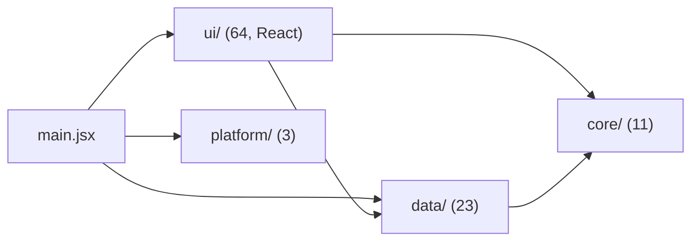

# code-structure-and-patterns.md — 파일마다 하는 일과 쓴 패턴

> 코드 파일 하나하나가 **무슨 일을 하는지**, **어떤 기능(spec)을 맡는지**, **어떤 방법으로 만들었는지**, **어떤 패턴·원칙을 썼는지** 정리한 문서예요.
> 기준: **React 버전** (`migrate-to-react`). `core/`·`data/`는 v13 원본 그대로이고, `ui/`만 React(JSX + 훅)로 다시 짰어요.
> 비교용 원본 v13(`moyeo-v13.html`, `v13-src/`)은 React 코드와 겹쳐서 2026-10-15에 `_to_delete/legacy/`로 옮겼어요 (미미가 확인 뒤 지움).
> 층·의존·패턴의 뜻은 [`architecture.md`](architecture.md), 문법은 [`tech-stack.md`](tech-stack.md) 7번, 원칙의 원문은 [`coding-rules.md`](coding-rules.md)에 있어요.
> 전체 파일 트리는 [`file-tree.md`](file-tree.md), OpenSpec 문서 쓰는 법은 아래 8번이에요.

---

## 1. 한눈에

| 층 | 폴더 | 파일 수 | 하는 일 | 얼마나 자주 바뀌나 |
|---|---|---|---|---|
| Core | `src/core/` | 11 | 정해진 값, 시간 계산, 소리, 작은 도구 | 거의 안 바뀜 |
| Data | `src/data/` | 23 | 데이터 보관, 규칙, 저장, 서버(가짜·Firebase), 로그인 | 가끔 |
| UI | `src/ui/` | 64 | 화면 그리기 (React 컴포넌트 + 훅) | 자주 |
| Platform | `src/platform/` | 3 | 빌드 대상(웹 / 앱인토스 / 안드로이드), 켜고 끄는 기능 표, 토스 SDK 불러오기 | 빌드 대상이 늘 때 |
| 서버 | `firestore.rules`, `storage.rules`, `functions/` | 3 | 서버 보안 규칙, 서버 함수(토스 로그인·회원탈퇴·24시간 정리) | 서버 기능이 늘 때 |
| 조립 | `src/main.jsx` | 1 | 부품을 만들어 ctx에 담고 `<App>` 실행 | 부품이 바뀔 때만 |
| 모양 | `styles/` | 9 | CSS | 화면 모양이 바뀔 때 |

**의존 방향**: `ui` → `data` → `core` 한 방향만. 반대로 import하는 파일은 없어요 (SDP, ADP).

---

## 2. 파일 트리

전체 파일 트리(코드·문서·OpenSpec·시험·도구, 앞으로 생길 파일까지)는 [`file-tree.md`](file-tree.md)에 따로 모았어요.
아래 3번은 그 트리의 코드 파일을 하나씩 자세히 설명해요.

---

## 3. 파일별 자세히

표의 "기능"은 `openspec/specs/<기능>/spec.md` 이름이에요. "공통"은 여러 기능이 같이 써요.

### 3-1. 조립 — `src/main.jsx`

| 하는 일 | 기능 | 어떻게 | 패턴·원칙 |
|---|---|---|---|
| Store, 서버, 소리, 화면 부품을 **모두 여기서만** 만들고 `ctx` 꾸러미에 담아 `<AppProvider>`로 넘김. CSS 9개도 여기서 순서대로 불러옴 | 공통 | `createContext()` 한 함수에서 순서대로 `new`. `notifier.subscribe(() => view.emit())`로 데이터 변화를 화면 알림판에 연결. 첫 터치 때 `engine.unlock()`. StrictMode는 안 씀(시작 타이머가 두 번 돌면 원본과 달라져서) | **Composition Root**, **의존성 주입(DI)**, **DIP**. `.env`에 Firebase 설정이 있으면 `RealServer`(+ 빌드별 로그인: 토스 `AnonKeyLogin`, 그 밖 `DemoLogin`), 없으면 `FakeServer`와 시연 데이터 |

### 3-1b. Platform — `src/platform/`

| 파일 | 하는 일 | 어떻게 | 패턴·원칙 |
|---|---|---|---|
| `target.js` | 지금 빌드가 어디용인지 (`web` / `toss` / `android`) | Vite `--mode` 값(`import.meta.env.MODE`)을 표로 바꿈 | **표로 다루기** |
| `features.js` | 빌드 대상별 켜고 끄는 기능 (`canSwipe`, `canShareLocation`, `canSendPhoto`, `filterMessages`, 토스 출시 체크리스트용 `askPingOnStart`·`lightThemeOnly`·`ownBackButtons`) | 주석으로 막지 않고 true/false 스위치. 토스는 둘 다 false → 탭 3개(채팅·친구·나), 위치 공유 토글 없음. 법인 등록 뒤 `canSwipe`, 위치 신고·동의 창 뒤 `canShareLocation`을 true로 | **표로 다루기**, **OCP**, 시험 가능(`featuresFor`) |
| `tossSdk.js` | 앱인토스 SDK (토스 빌드에서만): `loadTossUser`(익명 사용자 키), `listenTossBack`(토스 뒤로가기 → `nav.back()`, 닫을 창 없으면 `closeView()`) | `import()`로 필요할 때만. 토스 빌드가 아니면 `vite.config.js`가 SDK를 묶지 않음(external) → 설치 전에도 다른 빌드 가능 | **Adapter**, **DI**(`AnonKeyLogin`에 넣어줌) |

### 3-2. Core — `src/core/`

| 파일 | 하는 일 | 기능 | 어떻게 | 패턴·원칙 |
|---|---|---|---|---|
| `config.js` | 시간·개수·크기·색·문구를 이름 붙여 모음 | 공통 | `export const`만 있음. `SECOND`·`MINUTE`·`HOUR`로 시간 계산 | **숫자 대신 이름**(매직 넘버 없애기), **DRY** |
| `result.js` | 성공이면 값, 실패면 이유를 돌려주는 모양 | 공통 | `Result.ok(value)` → `{ isOk: true, value }`, `Result.fail(reason)` → `{ isOk: false, reason }` | **Result 패턴** (null 대신 이유) |
| `time.js` | "방금/5분/3시간", "23시간 남음", 만 나이, 달마다 날짜 수 | chat, story, account | 작은 함수들. `new Date(년, 월, 0)` = 그 달 마지막 날. 생일이 지났는지 비교해서 만 나이 | **순수 함수**(같은 입력이면 같은 결과), **PIE** |
| `dom.js` | 요소 찾기, 특수문자 바꾸기, 고유 번호 | 공통 | `$`·`$$`는 `querySelector` 줄임, `esc`는 `& < > " '`를 바꿔 HTML 안전하게 | **DRY**, 보안(글자로 HTML이 끼어드는 것 막기) |
| `icons.js` | 아이콘 SVG 모음 | 공통 | `ICON_PATHS` 표에서 이름으로 찾아 20px SVG 글자를 돌려줌 | **표로 다루기**(새 아이콘 = 한 줄, **OCP**), **디자인 토큰**(`ICON_SIZE`) |
| `ChangeNotifier.js` | "데이터가 바뀌었어요" 알림판 | 공통 | `subscribe(fn)`으로 등록, `notify(...주제)`로 무엇이 바뀌었는지 같이 알림 (주제는 `topics.js`) | **Observer**, **ADP**(Data가 UI를 import하지 않게) |
| `sound/AudioEngine.js` | 브라우저 소리 장치를 준비하고 음 하나를 냄 | 공통 | WebAudio `AudioContext`. 브라우저가 첫 터치 전에는 소리를 막아서 `unlock()`을 따로 둠 | **SRP**(소리 장치는 여기만), **DRY**(모든 소리가 같이 씀) |
| `sound/Sound.js` | "소리 파일 있으면 파일, 없으면 임시 소리" 규칙 | 공통 | `play()`가 순서를 정하고, 자식은 `playDefault()`만 만듦. 안 만들면 예외 | **Template Method**, **상속**, 버그는 **예외** |
| `sound/NotificationSound.js` | 새 메시지 "띵-동", 끌 수 있음 | chat, account | `Sound`를 물려받아 `playDefault()`에서 음 두 개. `isEnabled`가 false면 안 냄 | **LSP**(`Sound` 자리에 넣어도 똑같이 `play()`) |
| `sound/BubbleSound.js` | 소리 울리기 "뽀글뽀글" | ping | `Sound`를 물려받아 짧은 음 여러 개 | **LSP** |
| `sound/ToggleSound.js` | 토글 "톡" (켤 때 높게, 끌 때 낮게) | account, ping | `Sound`를 **물려받지 않음**. 파일 기능이 필요 없어서 | **ISP**(안 쓰는 기능 억지로 갖지 않기) |

### 3-3. Data — `src/data/`

| 파일 | 하는 일 | 기능 | 어떻게 | 패턴·원칙 |
|---|---|---|---|---|
| `sampleData.js` | 시연용 사람 8명(teo24, gustavo31 …), 메시지, 좋아요, 스토리 | 공통 | 함수가 "지금 시각" 기준으로 만들어 돌려줌 (`createSampleUsers(now)`) | **Fake 데이터**. 진짜 서버가 생기면 지움 |
| `UserStore.js` | 나와 다른 사람, 친구, 지도에 보일 친구(`friendsOnMap`: 위치 공유를 켠 친구), 신고, 아이디 중복·찾기, 내 사진 | 공통 | 목록은 항상 `visible()`(신고한 사람 뺌)을 거쳐 꺼냄. 사진 추가는 `Result` | **Store**, **SRP**, **Result**(사진 10장 초과) |
| `ChatStore.js` | 대화, 안 읽은 수, 입력 중, 저장, 24시간 삭제 | chat | `filter`로 24시간 지난 것 지우기(저장한 것 빼고), `reduce`로 안 읽은 수 합치기. 바뀌면 `notify()` | **Store**, **Observer**, **Result**(메시지 없음), 배열 메서드 |
| `StoryStore.js` | 스토리 24시간, 남은 비율, 봤는지, 내 좋아요 | story | 남은 비율 = 남은 시간 ÷ 24시간. "본 것"은 올린 시각으로 기억해서 새 스토리면 다시 "안 봄". 좋아요 열쇠는 "사람:올린시각" | **Store**, **Result**(사라진 스토리) |
| `LikeStore.js` | 좋아요 보내기·받기·수락·거절, X(1시간 숨김), 스와이프에 보여줄 사람, 하트 숫자 | swipe, friends | `send()`는 상대가 이미 좋아했으면 `"matched"`, 아니면 `"sent"`. `Set`으로 보낸 사람·거절한 사람, 객체로 X 한 시각 | **Store**, **Result**, `Set` |
| `SwipeLimit.js` | 1시간에 10명 세기 (몇 명인지는 `config.js`의 `SWIPE_LIMIT`), 남은 수, 다음 자리가 열리는 시각 | swipe | 본 시각 목록에서 1시간 지난 것을 `filter`로 빼고 셈 | **SRP**(세기만 따로), 시험하기 쉬움 |
| `FriendSearch.js` | 아이디로 정확히 한 명 찾기 | friends | 모양 검사(`Validator`) → 내 아이디인지 → 서버에서 찾기(`await`, Promise). 모두 `Result` | **Result**, **SRP**, **DRY**(가입과 같은 검사 재사용) |
| `AccountService.js` | 가입, 아이디 중복 검사, 불러오기(로그인 먼저), 닉네임, 권한, 회원탈퇴 | account, profile, ping | 여러 Store·저장소·서버를 엮음. 검사 3개 중 `find`로 첫 실패 이유. 가입·불러오기·탈퇴는 서버에 물어서 `async`. 바꿀 때마다 `save()` = 이 기기 저장 + `server.updateProfile` | **Service**, **Result**, **DRY**(저장을 한 곳에) |
| `ProfileRepository.js` | 가입 정보 저장·불러오기·지우기 | account | `localStorage` + 못 쓰면 메모리 복사본. 실패해도 앱이 멈추지 않게 `try/catch` | **Repository**(저장 방법을 숨김), **Result**(가입 정보 없음) |
| `Validator.js` | 아이디·닉네임·생년월일·관심사·스토리 글 검사 | account, friends, profile, story | 아이디는 소문자로 바꾸고 정규식 `/^[a-z0-9]+$/`, 길이, 만 14세 | **Result**(잘못된 입력은 흔한 일), **PIE** |
| `MessageFilter.js` | 대화 규칙 검사: 개인정보 공유(전화번호·SNS·이메일·주소)·도박·욕설을 `****`로 가리고 걸린 종류(`violations`)를 돌려줌 | chat (SAFE-05~06) | 종류마다 정규식 표를 `reduce`로 차례로 적용. 숫자 뒤에 단위(분·시·개…)가 오면 주소로 보지 않음. 서버 함수는 `tools/copy-shared.mjs`가 복사한 것을 씀 (원본 하나) | **표로 다루기**(새 말 = 한 줄), 순수 함수(시험) |
| `sanctionRules.js` | 제재 기준 한 곳: `addStrike(기록, 지금)` → 위반 1회 경고 · 2회 7일 정지 · 3회 이상 영구정지, `isSuspended(기록, 지금)` | chat (SAFE-08~10c) | 순수 함수, 다른 파일을 import하지 않음 (서버 함수에도 그대로 복사돼서) | **DRY**(앱·서버 같은 기준), 순수 함수(시험) |
| `ModerationStore.js` | 내 위반 횟수·정지 끝나는 날·영구정지. `addWarning()` → `{ warnings, level }` | chat (SAFE-08~11) | 기준은 `sanctionRules.js`. 시연 모드는 저장소 칸 하나(`ProfileRepository("moyeo.moderation")`), 진짜 서버는 `moderation/{uid}`를 `applyServer`로 덮어씀 | **Store**, **Observer** |
| `PingService.js` | 소리 울리기: 친구만, 30초에 한 번, 허락 여부 | ping | 친구마다 마지막 보낸 시각을 기억. 남은 초는 올림 | **Service**, **Result** |
| `imageReader.js` | 사진 파일을 화면용 주소(data URL)로 읽기 (한 장 / 여러 장) | profile, chat, story | `FileReader`를 `Promise`로 감싸 `await`로 씀. 사진 아니면 실패 | **Result**, `async/await` |
| `server/ChatServer.js` | 서버가 꼭 해야 할 일 목록 (로그인·가입, 내 정보·사진, 메시지·저장, 입력 중, 좋아요·거절·친구, 신고, 아이디, 회원탈퇴, 스토리·스토리 좋아요, 위치) + 소식 구독 | 공통 | 자바스크립트에는 interface가 없어서 부모 클래스로 약속. 안 만든 함수를 부르면 예외. 서버 답을 기다리는 일(`signIn`, `register`, `findUserByHandle`, `deleteAccount`)은 Promise | **DIP**(화면은 이것만 앎), **Observer**(`onMessage`, `onEvent`: accepted·storyLike·offline·error), 버그는 **예외** |
| `server/FakeServer.js` | 진짜 서버 흉내 | chat, swipe, story, home-map, ping | `setTimeout`으로 입력 중 → 자동 답장, 4초 뒤 수락, 3·6초 뒤 스토리 좋아요. `setInterval` 3초마다 위치 이동. 로그인은 "이 기기 저장 정보를 써요"(`isLocal`), 올리기는 아무 일 없음 | **Fake Object**, **상속**(`extends ChatServer`), **LSP**(Promise 모양도 같게) |
| `server/RealServer.js` | 진짜 서버 (Firebase) | 공통 (sync, account) | 처음 로그인할 때만 Firebase를 `import()`. 로그인 → 내 문서 읽기 → `connect()`에서 구독하고 받은 것을 Store에 넣음(`upsertUser`, `upsertMessage`, `receive`). **구독 수는 친구 수와 상관없이 일정**(2026-10-20): 모든 대화는 `members` 질문 하나(`receiveMessage`), 입력 중은 `typing/{나}` 하나(`receiveTyping`), 친구 정보·스토리는 `feeds/{나}/friends` 하나. 사진 스토리는 저장소에 올리고 주소만. 쓰기 실패는 `"error"` 소식 → 배너. 위치는 아직(add-google-map 뒤) | **Adapter**(서버 문서 ↔ Store), **Observer**, **LSP**, **DI**(로그인 방법을 밖에서 받음), **Result** |
| `server/firebase/firebaseApp.js` | Firebase 연결 하나 만들기 (로그인·Firestore·Storage·서버 함수) | 공통 | `.env`의 `VITE_FIREBASE_*`. 오프라인 저장(`persistentLocalCache`) 켬. `VITE_FIREBASE_EMULATOR=true`면 에뮬레이터 | **Factory**, 설정은 `.env`에만 |
| `server/firebase/paths.js` | 서버 문서 이름 규칙 (`pairId` = "작은uid_큰uid", 좋아요·차단 id) | 공통 | `firestore.rules`와 같은 규칙. 누가 먼저 만들어도 같은 이름 | **DRY**(이름 규칙 한 곳), 순수 함수(시험) |
| `server/firebase/userMapper.js` | 서버 문서 ↔ 화면용 사람·메시지·가입 정보 | 공통 | 공개 문서엔 나이만, 생년월일은 비공개 문서. 서버 사람은 거리(`km`) null, 동네 빈칸. 스토리 칸은 덮어쓰지 않음 | **Adapter**, 순수 함수(시험) |
| `server/firebase/shrinkImage.js` | 올리기 전에 사진 줄이기 (긴 변 1280px, JPEG) | profile, chat | `<canvas>`로 다시 그림. 못 줄이면 원본 | **SRP**, 요금 줄이기 |
| `login/LoginProvider.js` | "로그인 방법" 약속: `signIn({ auth, functions })` → `Result<uid>` | account | 부모 클래스 약속. 실패는 Result | **DIP**, **Strategy** |
| `login/AnonKeyLogin.js` | 토스: 익명 사용자 키 → 서버 함수 `tossLogin` → Firebase 맞춤 토큰 (화면 없음) | account | 토스 SDK·서버 함수 호출·토큰 로그인을 생성자로 받아서 시험에서 가짜로 바꿔 끼움. SDK가 없으면 "토스 앱 업데이트" | **Strategy**, **DI**, **Result** |
| `login/DemoLogin.js` | 웹에서 서버 시험: Firebase 익명 로그인 (화면 없음, 브라우저마다 다른 사람) | account | `authStateReady()` 뒤 로그인돼 있으면 그대로, 아니면 `signInAnonymously` | **Strategy** |

### 3-3b. 서버 — `firestore.rules`, `storage.rules`, `functions/` (add-real-server)

| 파일 | 하는 일 | 어떻게 | 패턴·원칙 |
|---|---|---|---|
| `firestore.rules` | 누가 무엇을 읽고 쓸 수 있는지 (**진짜 규칙은 여기**) | 친구만 대화·스토리·입력 중, 상대가 좋아요를 보냈을 때만 친구 맺기, 아이디는 문서 하나 = 한 명, 서로 신고한 사이는 못 읽음, 생년월일은 비공개 문서 | 보안은 서버에서, **최소 권한** |
| `storage.rules` | 사진 저장소 규칙 | 내 사진은 나만 올림, 대화 사진은 그 두 친구만. 사진·5MB까지 | **최소 권한** |
| `firebase.json`, `firestore.indexes.json` | Firebase 설정 (규칙 파일, 서버 함수 폴더, 에뮬레이터 포트), 24시간 정리용 색인 | `npm run emulators`, `npm run deploy:server` | 설정 한 곳 |
| `functions/index.js` | 서버 함수 8개: 친구 소식 복사 `fanOutProfile`·`fanOutStory`(내 정보·스토리가 바뀌면 친구들의 `feeds`에), `linkFeeds`·`unlinkFeeds`(친구가 되거나 끊기면 서로의 `feeds`·입력 중 칸 정리) + `moderateMessage`( 새 메시지를 `shared/MessageFilter.js`로 다시 검사·가리고 `shared/sanctionRules.js` 기준으로 `moderation/{uid}`에 위반 1회 → 경고·7일 정지·영구정지): `tossLogin`(토스 코드 → mTLS로 anonKey → 맞춤 토큰), `deleteAccount`(모든 데이터 + 계정 삭제), `cleanup`(매시간 24시간 지난 메시지·스토리·사진) | 서울 지역. mTLS 인증서는 비밀값(`defineSecret`). 많이 지울 때는 400개씩 나눠서 다음 묶음을 다시 부름 | **SRP**(함수마다 한 일), **Result 대신 HttpsError**(서버→앱) |

### 3-4. UI — `src/ui/` (React)

**공통 규칙**: 그리는 HTML(태그·클래스·순서)은 v13과 같게 → CSS 9개를 그대로 써서 화면이 같아요 (`npm run compare`로 확인).
데이터가 바뀌면 `ctx.view`가 울리고 `App`이 다시 그려요. 매초·3초마다 바뀌는 것(테두리, 핀)은 그 부품만 따로 구독해요.

#### 틀 — `app/`

| 파일 | 하는 일 | 기능 | 어떻게 | 패턴·원칙 |
|---|---|---|---|---|
| `App.jsx` | 시작 순서(로고 → 로그인 → 가입/첫 탭), 지금 탭, 탭바, 덮개 창·배너 자리 | app-shell, account | 처음 그린 뒤 `useEffect`로 로고 창을 열고, 끝나면 `await loadSaved()` 결과로 가입 창 또는 시작. 로그인 자체가 안 되면 배너 + 5초 뒤 다시. `ctx.view`·`ctx.tabs` 구독 | **Observer**(useStore), **SRP**(서버 소식은 serverEvents) |
| `AppContext.jsx` | ctx를 React 안으로 넘김 | 공통 | `createContext` + `useCtx()`. Provider 밖에서 부르면 예외(버그) | **의존성 주입** |
| `Observable.js` | 구독·구독 끊기·버전 숫자 | 공통 | 탭·창 목록·배너·시계(1초/3초)용 (React는 구독 끊기가 필요) | **Observer** |
| `ChangeHub.js` | 주제별 알림판 | 공통 | 주제마다 버전 숫자. `emit(주제들)`은 그 주제를 구독한 부품만, `emitAll()`(nav.refresh)은 전부. 한 번에 여러 주제가 바뀌어도 같은 부품은 한 번만 | **Observer**, 성능 |
| `TabStore.js` | 지금 탭 | app-shell | 배너를 눌러 탭을 옮겨야 해서 React 밖에서도 바꿀 수 있게 Store로 | **Observer** |
| `tabs.js` | 탭 5줄 표 + 빌드별로 숨길 탭 | app-shell | `{ id, icon, label, Screen, isFixed, feature }`. `tabsFor(features)` | **표로 다루기**, **OCP**(탭 추가 = 한 줄) |
| `OverlayStore.js` | 덮개 창 목록 (원본 Layers 대신) | app-shell | 배열로 열린 순서를 기억. `open`(닫는 함수를 돌려줌), `closeKinds`, `closeWhere`, `closeTop`(Phase 3 뒤로 버튼) | **Observer**, **SRP** |
| `OverlayHost.jsx` | 덮개 창들을 연 순서대로 그림 | app-shell | 창마다 `memo` → 다른 창이 열려도 다시 그리지 않음(원본처럼 연 순간 모습 그대로) | **성능**, **Composition** |
| `createNav.jsx` | `ctx.nav`: 탭 이동, 채팅방·프로필·스토리·전화·신고·친구 목록·권한 창 열기, 회원탈퇴 | 공통 | 원본 App.createNav와 같은 함수 이름 → `FriendActions`는 안 고침. `isChatOpenWith`는 OverlayStore에 물어봄 | **Mediator**, **OCP** |
| `serverEvents.js` | 서버 소식 → 알림음 + 배너 (`offline`·`error`는 이유 글만 배너로), 1초(`clock`)·3초(`locationTick`)·15초(24시간 정리) | app-shell, chat, story | 앱 시작 때 한 번만 `connectServer(ctx)` | **Observer**, **SRP** |

#### 훅 — `hooks/`

| 파일 | 하는 일 | 어떻게 | 패턴·원칙 |
|---|---|---|---|
| `useStore.js` | 알림판이 울리면 다시 그림 | `useSyncExternalStore(subscribe, getVersion)` | **Custom Hook**, **Observer** |
| `useChanges.js` | 내가 그리는 데이터의 주제만 구독 | `useChanges(TOPIC.chats, TOPIC.chat(id))` → 구독한 주제들의 버전 글자가 바뀔 때만 다시 그림 | **Custom Hook**, 성능 |
| `useKept.js` | 탭을 옮겨도 남는 값 (STO-32, FRD-17) | `useState`와 같은 모양, 값은 `ctx.kept`(Map)에도 적어둠 | **Custom Hook** |
| `useDrag.js` | 포인터 끌기 공통 (시작 / 움직임 dx / 끝) | 위치는 `useRef`에 둬서 매 움직임마다 다시 그리지 않음 | **Custom Hook**, **DRY**(3곳이 같이 씀) |
| `useInterval.js` | setInterval + 화면이 사라지면 자동 정리 | `useEffect` 정리 함수 | **Custom Hook** |

#### 공통 부품 — `common/`과 행동(Controller) — `actions/`

> View(`.jsx`)는 그리기와 입력 받기만, Store·서버를 바꾸는 일은 `actions/`가 해요 (CLAUDE.md 6번 "구조와 성능").

| 파일 | 하는 일 | 기능 | 어떻게 | 패턴·원칙 |
|---|---|---|---|---|
| `actions/FriendActions.js` | 좋아요, 수락, 받은 좋아요 거절, 소리 울리기 + 결과 배너 | swipe, friends, profile, ping | Store 바꾸기 + 서버에 알리기를 한 곳에서. `ctx.toast`·`ctx.nav` 모양은 원본 그대로 | **Controller**, **DRY** |
| `actions/ChatActions.js` | 글·음성·사진 보내기, 대화 규칙 검사 → 경고 줄·이용정지, 입력 중, 두 번 터치 저장, 스토리 좋아요 | chat, story | View는 입력만 넘기고 결과(true/Result)로 입력 칸 비우기·배너 | **Controller**, **Result** |
| `actions/SafetyActions.js` | 신고(길게 누른 메시지 포함)·차단·차단 풀기 + 그 사람 창 닫기·배너 | chat, friends, profile | 신고 창·차단 창·나 탭이 같은 일을 한 곳에서 | **Controller**, **DRY** |
| `actions/MeActions.js` | 프로필 사진 추가·삭제, 위치 공유·알림음 토글("톡"), 스토리 올리기·지우기 | profile, story, account | 알림음은 `NotificationSound.toggle()` (필드를 밖에서 바꾸지 않기) | **Controller**, **캡슐화** |
| `Icon.jsx` | 아이콘 | 공통 | `core/icons.js`의 SVG 글자에서 안쪽 선 그림만 꺼내 같은 `<svg>`로 | **DRY**(그림은 한 곳), **Adapter** |
| `views.jsx` | Avatar, Square, Photo, TypingAnim, Dots, TopBar + `kmText`·`joinDots` | 공통 | 원본 `views.js`와 같은 HTML. 사진이 없으면 이름 첫 글자. 거리·동네를 모르는 사람(토스·서버)은 빈 칸을 빼고 " · "로 이음 | **DRY**, **Composition** |
| `NavBar.jsx` | 하단 탭 + 빨간 숫자 | app-shell | 숫자가 0이면 안 그림 | **OCP** |
| `ToastStore.js` / `ToastView.jsx` | 위쪽 알림 배너 | app-shell | `show(title, { sub, onTap })` 모양은 원본 그대로. 새 배너마다 `key`가 바뀌어 애니메이션이 다시 나옴. 오래된 배너의 타이머가 새 배너를 지우지 않게 id로 확인 | **Observer**, **기본값 + 객체 매개변수** |
| `Modal.jsx` | 어두운 바깥 + 가운데 팝업 | app-shell, chat, account, ping | `closeOnBackdrop`일 때만 바깥 누르면 닫힘 (SHELL-41·42) | **DRY**, **Composition** |
| `StoryRing.jsx` | 줄어드는 테두리 | story | `ctx.clock`(1초)만 구독해서 테두리만 다시 그림. `--p`는 원본과 같은 값 | **성능**, CSS 변수 + `@property` |
| `storyStyle.js` / `StoryText.jsx` | 글 스토리 모양 | story | 계산은 원본과 같고 HTML 대신 style 객체를 돌려줌 | **DRY**, 순수 함수(시험) |
| `DragSlider.jsx` | 크기 막대 | story | `useDrag` + 키보드 ← → | **SRP**, 접근성 |
| `PhotoCarousel.jsx` | 사진 넘기기 | profile | 끄는 동안은 style을 직접 바꾸고, 넘길 때만 상태(index)를 바꿈 | **SRP**, `useDrag` |
| `PhotoPicker.js` | 사진 고르기 + `pickImage()`(한 장 골라 읽기: 채팅·스토리 사진이 같이 씀) | profile, chat, story | `#fileInput`은 React가 그린 뒤 생겨서 고를 때마다 찾음 | **Adapter**, **DRY** |
| `PolicyText.jsx` | `docs/policy/*.md`를 화면에 그리기 (제목·목록·표·굵게·정책 링크) + `POLICY_DOCS` 목록 | chat, account (SAFE-07, 14) | Vite `?raw`로 .md 글을 그대로 읽음 → 원본은 docs 한 곳 | **DRY**(약관 글 한 곳), **표로 다루기** |
| `ColorPalette.jsx` | 색 팔레트 + `palette.open()` | story | 무지개 칸은 고르는 동안(input) 미리보기, 다 고르면(change) 닫기 | **SRP**, 원본과 같은 함수 모양 |
| `DateWheelPicker.jsx` | 년·월·일 바퀴 + `datePicker.open()` | account | CSS scroll-snap, 멈춘 뒤 0.12초에 값 확정, 날짜 수가 바뀌면 일 바퀴를 다시 굴려둠 | **SRP**, `daysInMonth` |

#### 시작 — `start/`

| 파일 | 하는 일 | 기능 | 어떻게 | 패턴·원칙 |
|---|---|---|---|---|
| `Splash.jsx` | 로고 1.6초 → 0.4초 사라짐 | app-shell | `useEffect` 안 타이머 두 개, 사라질 때 정리 | **SRP** |
| `SignupScreen.jsx` | 가입 화면 | account | 아이디 검사 결과는 글자에서 바로 계산(따로 저장 안 함). `register()`의 `Result`로 오류 문구. 한글 조합 중 Enter 무시 | **Result**, **KISS** |
| `BanScreen.jsx` | 이용정지 안내 (7일 정지 / 영구정지) | chat (SAFE-09, 10b) | `nav.showBan()`이 다른 창을 닫고 `kind: "ban"`으로 열어요. 닫는 버튼 없음, 뒤로가기로도 안 닫힘. 앱 시작·위반 2회째부터·서버 `banned` 소식 때 | **SRP** |

#### 탭 화면 — `screens/`

| 파일 | 하는 일 | 기능 | 어떻게 | 패턴·원칙 |
|---|---|---|---|---|
| `home/HomeScreen.jsx` 외 2개 | 꽉 찬 지도, 내 핀, 위치 공유를 켠 친구 핀 | home-map | 친구 목록은 `users.friendsOnMap()`. `MapPin`만 `locationTick`을 구독 → 3초마다 핀만 움직임. 지도 그림은 `memo`. 위치 공유는 나 탭 설정에서만 | **성능**, **Composition** |
| `chat/ChatListScreen.jsx` 외 2개 | 스토리 줄 + 대화 목록 | chat, story | 미리보기 규칙은 `lastMessagePreview()` 함수로 | **표로 다루기**(`MESSAGE_LABELS`) |
| `swipe/SwipeScreen.jsx` 외 3개 | 카드 끌기, 좋아요/넘기기, 남은 수, 빈 화면 | swipe | 끄는 위치는 `useRef`·style 직접(다시 그려도 안 튐, SWP-28). 날아가는 중 두 번 누름 막기. 빈 화면이면 `useEffect` 타이머로 저절로 다시 그림 | `useCardDrag`, **SRP**, 시험 가능한 `swipeEmptyText()` |
| `friends/FriendsScreen.jsx` 외 2개 | 친구 탭 | friends | 스토리 좋아요 "본 것" 표시는 그린 **다음**(`useEffect`)에 (FRD-32). 검색칸은 `useKept` | **Composition**, **SRP** |
| `me/MeScreen.jsx` 외 6개 | 나 탭 5부품 (내 정보, 사진, 관심사, 스토리, 설정) | account, profile, story | 쓰던 스토리(글·넣은 사진)·고른 칸·닉네임 편집 중은 `useKept`. 꾸미기 칸은 `storyParts.js` 표. [사진 추가]는 미리보기에 넣기만, 올리기는 [스토리 올리기] 하나 | **Composition**, **OCP**, **표로 다루기** |

#### 덮개 창 — `overlays/`

| 파일 | 하는 일 | 기능 | 어떻게 | 패턴·원칙 |
|---|---|---|---|---|
| `chat/` (6개) | 채팅방 | chat | 원본 240줄을 위쪽·메시지·입력창·녹음 4개로 (고칠 이유가 4개). 메시지 목록에 클릭 하나 + `closest(".bub")`. 저장하면 그 말풍선만 `key`를 바꿔 "톡" 효과. 그리기 전에(`useLayoutEffect`) 맨 아래로 | **SRP**, **이벤트 위임**, **Custom Hook**(`useVoiceRecorder`) |
| `profile/` (3개) | 전체 화면 프로필 + 상황별 버튼 | profile, ping | `ProfileActions`가 관계·연 곳에 따라 버튼 하나를 고름. 좋아요는 두 번 눌러도 한 번만 | **SRP**, **Composition** |
| `StoryViewer.jsx` | 스토리 보기 5초 | story | 연 순간의 스토리를 `useState`로 쥠, 5초 타이머는 닫히면 정리 | **Result**(좋아요) |
| `FriendList.jsx` | 친구 목록 | friends | 연 순간의 친구 목록 | **DRY**(`StoryRing`) |
| `CallScreen.jsx` | 전화 화면 | chat | `useInterval`로 1초마다, 2초 뒤부터 통화 시간 | **SRP** |
| `ReportDialog.jsx` | 신고 창, 차단 창 | chat | `openReportDialog(ctx, id, message)`: 메시지를 길게 눌러 열면 그 메시지도 서버 신고 기록에. 신고·차단하면 채팅방·프로필 닫고 다시 그림 | **표로 다루기**(`REASONS`) |
| `PolicySheet.jsx` | 정책 문서 보기 창 | account (SAFE-14) | `nav.openPolicy("terms.md")` → 아래 시트에 `PolicyText`. 문서 안 링크는 위에 하나 더 | **Composition** |
| `PingPermission.jsx` | 무음 소리 받기 묻기 + 설정 안내 | ping | 묻기 창은 바깥을 눌러도 안 닫힘 | **SRP**, `PING_SETTINGS_GUIDE` |

### 3-5. 모양 — `styles/`

| 파일 | 하는 일 | 기능 | 어떻게 | 패턴·기법 |
|---|---|---|---|---|
| `base.css` | 모든 화면의 바탕: 색, 글꼴, 크기 규칙, 앱 틀, 하단 탭, 아바타, 스토리 테두리, 버튼, 배너, 팔레트, 달력 | app-shell, story, account | 맨 위 `:root`에 크기·색 변수. 테두리는 `conic-gradient` + `@property --p`로 부드럽게 줄어듦. 어두운 모드는 `prefers-color-scheme`, 움직임 줄이기는 `prefers-reduced-motion` | **디자인 토큰**, CSS 변수, 접근성 |
| `start.css` | 로고 화면, 가입 화면, 아이디 검사 문구(초록/빨강), 생년월일 칸 | app-shell, account | 로고 사라질 때 `.out` 클래스로 투명해짐 | 클래스로 상태 표시 |
| `home.css` | 지도, 핀 | home-map | 지도는 화면을 꽉 채움. 핀 위치는 `left/top %`, 움직일 때 `transition`으로 부드럽게 | CSS 전환 효과 |
| `chat.css` | 스토리 줄, 대화 목록, 채팅방, 말풍선(받은 메시지 13px), 입력창, 전화, 신고 | chat | 저장한 말풍선 `.saved` 노란 테두리, `.pop` 튀는 효과, 입력 중 점 애니메이션 | 클래스로 상태 표시, `--fs-small` |
| `swipe.css` | 카드, 도장, X·하트 버튼, 남은 수, 다 봤을 때 안내 | swipe | 카드 `touch-action:none`(끄는 동안 화면이 스크롤되지 않게), 뒤 카드 `.behind` | 터치 처리 |
| `likes.css` | 친구 탭 검색칸, 받은 좋아요 줄, 알약 버튼 | friends | `.acceptbtn`, `.friendsbtn` 알약 모양 | 버튼 규칙(높이 38, 양옆 16) |
| `profile.css` | 전체 화면 프로필, 사진 줄, 위쪽 막대, 아래 버튼 | profile | 사진 카드 `touch-action:pan-y`(옆으로 밀기는 앱이, 위아래는 브라우저가), 끄는 중 `.dragging`으로 전환 효과 끔. `.grow`는 커지며 열림 | 터치 처리, 애니메이션 |
| `story.css` | 스토리 보기, 글 스토리 글자, 좋아요 버튼 | story | 폰트 배경 상자는 `box-decoration-break: clone`으로 줄마다 상자. 글 스토리 바탕은 검정 | CSS 기법 |
| `me.css` | 나 탭: 내 정보, 사진 격자, 스토리 만들기, 색 칸, 크기 막대, 토글, 회원탈퇴 | profile, story, account | 색 칸은 테두리·바탕 없이 `.on`이면 밑줄. 막대 선 4px·손잡이 18px, 토글 34×20px | 디자인 토큰 |

---

## 4. 패턴 → 어느 파일에 (거꾸로 찾기)

| 패턴·원칙 | 파일 |
|---|---|
| **Result 패턴** | `result.js`, `Validator.js`, `AccountService.js`, `FriendSearch.js`, `LikeStore.js`, `ChatStore.js`, `StoryStore.js`, `UserStore.js`, `PingService.js`, `ProfileRepository.js`, `imageReader.js` (+ 이 결과를 쓰는 UI) |
| **Observer** | `ChangeNotifier.js`, `ChatServer.js`(`onMessage`, `onEvent`), `Observable.js`·`TabStore.js`·`OverlayStore.js`·`ToastStore.js`, `useStore.js` |
| **Template Method** | `Sound.js` → `NotificationSound.js`, `BubbleSound.js` |
| **상속 + 다형성 (LSP)** | `Sound` 자식 2개, `ChatServer` → `FakeServer`, `Observable` 자식 3개 |
| **ISP** | `ToggleSound.js` (`Sound`를 물려받지 않음) |
| **DIP** | `ChatServer.js`(약속), `main.jsx`(바꿔 끼우는 곳), `useCtx()`로 부품을 받는 모든 컴포넌트 |
| **의존성 주입 + Composition Root** | `main.jsx`의 `ctx` → `AppContext.jsx` |
| **Mediator** | `createNav.jsx`의 `ctx.nav` |
| **Composition (조합)** | `MeScreen.jsx`(부품 4개), `FriendsScreen.jsx`, `ProfileView.jsx`(사진·정보·버튼), `ChatRoom.jsx`(위쪽·메시지·입력창) |
| **Repository** | `ProfileRepository.js` |
| **Service** | `AccountService.js`, `PingService.js`, `FriendActions.js` |
| **Adapter** | `PhotoPicker.js`, `Icon.jsx` |
| **Custom Hook** | `useStore`, `useKept`, `useDrag`, `useInterval`, `useCardDrag`, `useVoiceRecorder` |
| **Fake Object** | `FakeServer.js`, `sampleData.js` |
| **이벤트 위임** | `MessageList.jsx` (두 번 터치 저장, 길게 눌러 신고) |
| **표로 다루기 (OCP)** | `tabs.js`(탭), `features.js`(빌드별 기능), `icons.js`(`ICON_PATHS`), `storyParts.js`(`STYLE_PARTS`), `ReportDialog.jsx`(`REASONS`), `ChatRow.jsx`(`MESSAGE_LABELS`) |
| **디자인 토큰** | `base.css`(`--fs`, `--fs-small`, `--fs-title`, `--icon`, 색 변수), `icons.js`(`ICON_SIZE`) |
| **예외 (버그일 때만)** | `Sound.playDefault`, `ChatServer.*` 안 만든 함수, `useCtx()`를 Provider 밖에서 부름 |

**아직 안 쓴 패턴**: Command(실행 취소·끊겼을 때 보낼 메시지 줄 세우기가 생기면), State(통화 화면 상태가 많아지면), Singleton(쓰지 않음 — 시험하기 어려워져서).

---

## 5. 기능 → 어느 파일에 (거꾸로 찾기)

| 기능 (spec) | UI | Data | Core |
|---|---|---|---|
| `app-shell` | `App`, `OverlayStore`/`OverlayHost`, `createNav`, `serverEvents`, `ToastStore`/`ToastView`, `NavBar`, `tabs`, `views`, `Splash`, `Modal` | `ChangeNotifier`를 쓰는 모든 Store | `config`, `dom`, `icons`, `ChangeNotifier`, `sound/AudioEngine` |
| `account` | `SignupScreen`, `DateWheelPicker`, `SettingsPanel` | `AccountService`, `ProfileRepository`, `Validator` | `time`(만 나이), `sound/ToggleSound` |
| `profile` | `ProfileView`·`ProfileInfo`·`ProfileActions`, `PhotoCarousel`, `ProfileHeader`, `PhotoManager`, `PhotoPicker` | `UserStore`, `imageReader`, `AccountService` | `time` |
| `home-map` | `screens/home/*`, `SettingsPanel`(토글) | `UserStore`, `FakeServer`(위치) | `config` |
| `chat` | `screens/chat/*`, `overlays/chat/*`, `CallScreen`, `ReportDialog`, `BanScreen`, `PolicyText`·`PolicySheet` | `ChatStore`, `UserStore`, `FakeServer`, `MessageFilter`, `sanctionRules`, `ModerationStore` | `time`, `sound/NotificationSound` |
| `story` | `StoryRing`, `storyStyle`/`StoryText`, `StoryViewer`, `StoryEditor`, `ColorPalette`, `DragSlider` | `StoryStore`, `LikeStore`, `Validator`, `imageReader` | `config`(`STORY_TEXT`, `PALETTE_COLORS`) |
| `swipe` | `screens/swipe/*`, `FriendActions` | `LikeStore`, `SwipeLimit`, `FakeServer` | `config` |
| `friends` | `screens/friends/*`, `FriendList`, `FriendActions` | `FriendSearch`, `LikeStore`, `UserStore` | `time` |
| `ping` | `PingPermission`, `ProfileActions`, `FriendActions`, `SettingsPanel` | `PingService`, `AccountService` | `sound/BubbleSound`, `config`(`PING_SETTINGS_GUIDE`) |

---

## 6. 데이터가 흐르는 길 (예시 5개)

### 예시 1. 친구에게서 새 메시지가 올 때
1. `FakeServer.fakeReply()`가 상대를 "입력 중"으로 바꿈 (`ChatStore.setTyping`)
2. `ChatStore`가 `ChangeNotifier.notify()`로 "바뀌었어요"
3. `main.jsx`가 연결해 둔 `ctx.view`가 울리고 `App`(useStore)이 탭바와 대화 목록을 다시 그림 → 목록에 "입력 중 ●●●"
4. 1.8초 뒤 메시지 추가(`ChatStore.addMessage`), 서버가 `emitMessage()`
5. `serverEvents.js`의 `onNewMessage()`가 빨간 숫자 +1, 알림음, 누를 수 있는 배너 (그 방을 보고 있으면 `nav.isChatOpenWith`로 확인하고 아무것도 안 함)

### 예시 2. 가입할 때 아이디 검사
1. 아이디 칸에 쓸 때마다 `SignupScreen`이 다시 그려지며 검사
2. `AccountService.checkHandle()`이 먼저 `Validator.handle()`로 **모양** 검사
3. 맞으면 `server.isHandleTaken()`으로 **중복** 검사
4. 모두 `Result`로 돌아와서 실패면 빨간 이유, 성공이면 초록 글씨

### 예시 3. 스와이프에서 하트를 누를 때
1. `SwipeScreen`의 `fly()`가 하트를 꽉 찬 하트로 바꾸고(`isLiking`) 카드를 날림(`flyCard`)
2. 0.35초 뒤 `swipeLimit.record()` + `FriendActions.like()`
3. `LikeStore.send()`: 상대가 이미 좋아했으면 `"matched"`(바로 친구), 아니면 `"sent"`
4. `"sent"`면 `server.sendLike()` → 시연에서는 4초 뒤 `emitEvent("accepted")`
5. `serverEvents.js`의 `onServerEvent()`가 "친구가 됐어요" 배너

### 예시 4. 앱을 다시 켤 때 (가입 화면이 안 나오는 이유)
1. `App`이 로고 창(`Splash`)이 끝나면 `AccountService.loadSaved()`
2. `ProfileRepository.load()`가 저장소에서 찾아 `Result.ok` 또는 `Result.fail`
3. 있으면 바로 시작(`start`), 없을 때만 가입 창(`SignupScreen`)
4. 회원탈퇴는 `AccountService.withdraw()` → 서버 계정·저장 정보 삭제 → 페이지 새로 불러오기

### 예시 5. 아이디로 친구 찾기
1. 검색칸에 쓰고 "찾기" (`FriendSearchBox`의 `search`)
2. `FriendSearch.find()`가 `Validator.handle()`로 모양 검사 + 소문자로
3. 내 아이디면 "내 아이디예요", 아니면 `server.findUserByHandle()` (신고한 사람은 안 나옴)
4. `Result`에 따라 찾은 사람 한 줄 또는 이유 한 줄, 버튼은 관계에 따라

---

## 7. 이 문서를 고치는 때

- 파일을 더하거나 지우거나 하는 일이 바뀌면 **같은 작업 안에서** 이 문서와 [`file-tree.md`](file-tree.md)를 같이 고쳐요 (`openspec/config.yaml` tasks 규칙).
- 3번 표는 `migrate-to-react`에서 React 파일(`.jsx`, 훅)로 바꿨어요. 원본 v13 파일 설명이 필요하면 `_to_delete/legacy/v13-src/`의 각 파일 맨 위 주석을 보세요.

---

## 8. OpenSpec 문서 쓰는 법

[OpenSpec](https://github.com/Fission-AI/openspec) 방식을 따라요. **"지금 앱이 하는 일"**은 `openspec/specs/`, **"바꾸려는 일"**은 `openspec/changes/`에 있어요 (위치는 [`file-tree.md`](file-tree.md)).

### spec 쓰는 법

| 단위 | 모양 | 예 |
|---|---|---|
| 요구사항 | `### Requirement: 이름` + **SHALL**이 들어간 문장 | "앱은 … 보여줘야 한다(SHALL)" |
| 시나리오 | `#### Scenario: 번호 이름` + **WHEN** / **THEN** | `#### Scenario: CHAT-31 양쪽 구분` |

시나리오 이름 앞의 번호(SHELL-, ACC-, PRO-, MAP-, CHAT-, STO-, SWP-, FRD-, PNG-)는 tasks와 시험에서 그 동작을 가리킬 때 써요.

### 변경 폴더 안

| 파일 | 질문 | 내용 |
|---|---|---|
| `proposal.md` | **왜, 무엇을** 바꾸나 | 이유, 바뀌는 것, 영향받는 기능 |
| `specs/<기능>/spec.md` | 동작이 **어떻게 달라지나** | ADDED / MODIFIED / REMOVED 요구사항 (동작이 안 바뀌면 없음) |
| `design.md` | **어떻게** 만드나 | 결정과 이유, 위험, 기능별 파일 설계 |
| `tasks.md` | **어떤 순서로** 만드나 | 체크리스트, 칸마다 확인 방법 |

변경이 끝나면 `openspec archive <이름>`으로 바뀐 동작을 `openspec/specs/`에 합치고, 변경 폴더는 `archive/`로 옮겨요.
Claude Code에서는 `/opsx:propose`(변경 만들기), `/opsx:apply`(만들기), `/opsx:archive`(보관)로 같은 일을 해요.
