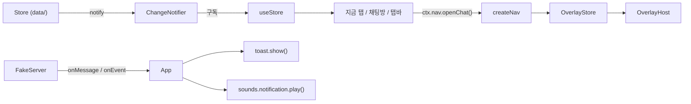
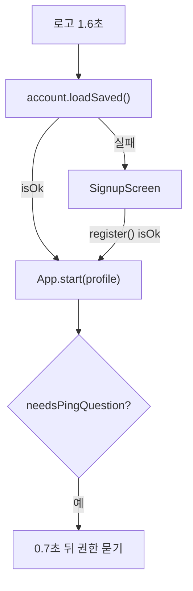
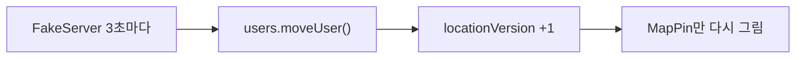
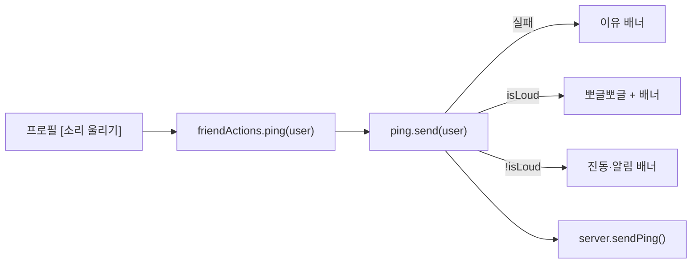

# Design

## Context

- 지금 코드: 순수 자바스크립트 59개 파일 + CSS 9개 (파일별 역할은 `docs/code-structure-and-patterns.md`).
- `src/core/`, `src/data/`는 화면을 몰라요. `src/ui/`만 HTML 글자를 만들어 `innerHTML`로 넣어요.
- 화면 모양은 전부 CSS 클래스 이름으로 정해져 있어요. **HTML 모양(태그·클래스·순서)이 같으면 화면도 같아요.**
- 쓰는 기술과 버전, 금지 기술은 `docs/tech-stack.md`가 정해요.

## Goals / Non-Goals

**Goals:**
- `openspec/specs/` 9개의 모든 시나리오가 원본과 똑같이 통과
- 원본과 화면 사진 비교 통과 (PC 1280×900, 폰 390×844)
- 파일 하나가 한 가지 일만 하도록 나누기 (SRP)

**Non-Goals:**
- 새 기능, 모양 바꾸기 (작은 개선이라도 이 변경에는 넣지 않음)
- 폰 앱 껍데기 (→ `add-mobile-apps`)
- 서버, GPS, 실제 지도 (→ `docs/roadmap.md` Phase 4)

## Decisions

### D1. `core/`와 `data/`는 그대로 옮긴다
- **이유**: React를 모르는 코드라 바꿀 필요가 없고, 그대로 두면 동작이 같다는 게 보장돼요.
- **대안**: 함께 다시 짜기 → 바뀌는 곳이 늘어서 비교가 어려워져 버림.

### D2. 기존 CSS를 그대로 쓰고 HTML 모양을 원본과 맞춘다
- **이유**: 화면이 안 바뀌게 하는 가장 확실한 방법이에요.
- **대안**: CSS Modules, Tailwind → 클래스 이름이 바뀌어 모양이 달라질 위험이 있어 버림.

### D3. Store 구독은 `useStore` 훅 하나 (`useSyncExternalStore`)
- `ChangeNotifier`가 알릴 때마다 버전 숫자를 올리고, 훅이 그 숫자를 읽어요. 숫자가 바뀌면 그 훅을 쓰는 부품만 다시 그려요.
- **대안**: Redux, Zustand → 지금 Store로 충분해서 YAGNI, `docs/tech-stack.md` 금지 목록.

### D4. 부르는 쪽 함수 모양은 그대로 둔다 (`toast.show`, `palette.open`, `datePicker.open`, `ctx.nav.*`)
- 안쪽만 React로 바꾸고 밖에서 부르는 방법은 같아서, `FriendActions` 같은 코드를 고치지 않아도 돼요 (OCP).

### D5. 덮개 창은 `OverlayStore` + `OverlayHost`
- 창 목록을 배열로 들고, `kind`는 원본 CSS 클래스/ID(`scrim`, `pview`, `story`, `chat`, `friendList`, `call`, `signup`, `splash`)와 1:1로 맞춰요.
- 원본 `layers.close(".scrim, .pview, .story, #chat")`는 `closeKinds([...])`가 돼요.

### D6. 끌기는 `useDrag` 훅 하나 + 위치는 `useRef`
- 원본에서 같은 포인터 코드가 3번(사진 넘기기, 카드, 크기 막대) 나와서 하나로 모아요 (DRY).
- 끄는 위치를 React state가 아닌 `useRef`에 두고 `style.transform`을 직접 바꿔요. 다시 그려져도 카드가 튀지 않고(SWP-28), 매 움직임마다 화면 전체를 다시 그리지 않아요.

### D7. 스토리 테두리는 `useClock(TICK_MS)`를 쓰는 `StoryRing`만 1초마다 다시 그린다
- 원본의 `ring.tick()`이 DOM을 직접 고치던 것과 결과(`--p` 값)가 같아요.

### D8. 데이터를 바꾸는 일은 그리는 도중이 아니라 `useEffect`에서
- 원본은 친구 탭을 그리는 도중 `markStoryLikesSeen()`을 불렀어요. React는 같은 화면을 두 번 그릴 수 있어서 그린 **다음**에 불러요 (FRD-32).

### D9. 회원탈퇴는 원본처럼 페이지를 새로 불러온다
- Store를 하나하나 비우는 것보다 단순하고 확실해요 (KISS).

### D10. 묶기는 Vite, 더블클릭 HTML은 `vite-plugin-singlefile`
- Vite 결과물은 서버나 앱 안에서 열어야 해요. 지금처럼 더블클릭해서 여는 한 장짜리 HTML이 필요해서 `build:single`을 따로 둬요.

## Risks / Trade-offs

- [React가 만든 HTML이 원본과 조금 다름 (공백, 속성 순서)] → CSS에 영향이 없는 차이만 허용. `npm run compare` 사진 비교로 확인
- [시간·위치처럼 매번 바뀌는 화면] → 비교할 때 그 부분을 가리고, 위치가 바뀌기 전(첫 3초)에 찍음
- [끌기 동작은 사진 비교로 못 잡음] → 각 기능 tasks에 손으로 확인하는 단계를 넣음
- [한 번에 다 옮기면 어디서 틀렸는지 모름] → 기능 하나씩 옮기고 그때마다 비교 (tasks 순서)

## Migration Plan

1. 원본 보관 → 뼈대 → 공통 틀 → 기능 9개를 하나씩 → 전체 비교
2. 기능 하나가 끝날 때마다 그 기능 시나리오 전체 + 사진 비교 통과 후 다음으로
3. 되돌리기: `legacy/moyeo-v13.html`과 이전 zip이 그대로 있어서 언제든 원본으로 돌아갈 수 있어요

## 기능별 설계

### 공통 틀 (`app-shell`)

#### 1. 파일

```text
index.html                    # <div class="app" id="app"> 하나만 두고 React가 안을 채움. CSS 9개는 main.jsx에서 import
src/main.jsx                  # 원본 main.js의 createContext() 그대로 + createRoot(#app).render(<AppProvider><App/></AppProvider>)
src/ui/app/
├─ AppContext.jsx             # ctx를 React 안으로 넘기는 통로. useCtx()로 꺼냄
├─ App.jsx                    # 시작 순서(로고 → 가입/홈), 지금 탭, 서버 소식 연결, 주기 타이머
├─ tabs.js                    # 탭 표: { id, icon, label, Screen, isFixed } 5줄 (OCP: 탭 추가 = 한 줄)
├─ OverlayStore.js            # 덮개 창 목록 (Observer). open / close / closeKinds / closeTop
├─ OverlayHost.jsx            # 목록을 순서대로 그림 (나중에 연 창이 위)
└─ createNav.js               # ctx.nav 만들기: goTab, refresh, openChat, openProfile … (원본과 같은 이름)
src/ui/hooks/
├─ useStore.js                # ChangeNotifier 구독 → 바뀌면 다시 그림 (useSyncExternalStore)
├─ useInterval.js             # setInterval + 화면이 사라질 때 자동 정리
└─ useClock.js                # n밀리초마다 지금 시각을 돌려줌 (스토리 테두리, 남은 시간 글자)
src/ui/common/
├─ Icon.jsx                   # <Icon name="chat"/> — core/icons.js의 ICON_PATHS를 그대로 씀
├─ views.jsx                  # Avatar, Square, Photo, TypingDots, Dots, TopBar (원본 views.js와 같은 HTML)
├─ NavBar.jsx                 # 하단 탭 5칸 + 빨간 숫자
├─ ToastStore.js              # 배너 하나를 기억 (Observer) + show(title, { sub, onTap }) — 원본과 같은 함수 모양
├─ ToastView.jsx              # 배너 그리기
└─ Modal.jsx                  # 가운데 팝업 틀 (.scrim.center > .modal) — 신고, 회원탈퇴, 권한 묻기가 같이 씀
src/ui/start/Splash.jsx       # 로고 화면
```

#### 2. 그려지는 모양 (원본과 같게)

```text
<div class="app" id="app">
  <div class="screen [fixed]" id="screen"> … 지금 탭 … </div>
  <nav class="nav" id="nav"> … 탭 5개 … </nav>
  <input type="file" id="fileInput" accept="image/*" hidden>
  … 덮개 창들 (OverlayHost: 연 순서대로) …
  … 배너 (ToastView) …
</div>
```

#### 3. 데이터 흐름



- **useStore**: `ChangeNotifier`가 알릴 때마다 숫자(버전)를 하나 올리고, 그 숫자를 `useSyncExternalStore`로 읽어요. 숫자가 바뀌면 그 훅을 쓰는 화면이 다시 그려져요.
- **원본은 채팅·친구 탭만 바로 다시 그렸어요.** React에서는 모든 화면이 `useStore`를 쓰지만, `useState`로 쥔 값(쓰던 글, 고른 칸, 끄는 중인 카드 위치)은 다시 그려도 남아서 결과가 같아요. 스와이프 카드는 끄는 동안 위치를 `useRef`에 두어 다시 그려도 안 튀게 해요.

#### 4. 덮개 창 관리 (Layers 대신)

| 원본 | React |
|---|---|
| `layers.add("scrim center", html)` | `overlays.open({ kind: "scrim", render: (close) => <Modal…/> , closeOnBackdrop })` |
| `layers.close(".scrim, .pview, .story, #chat")` | `overlays.closeKinds(["scrim", "pview", "story", "chat"])` |
| `layers.closeOnBackdrop(layer)` | `closeOnBackdrop: true` |
| (없음) | `overlays.closeTop()` — 맨 위 창 닫기. 다음 변경 `add-mobile-apps`의 안드로이드 뒤로 버튼이 씀 |

`kind`는 원본의 CSS 클래스/ID와 1:1로 맞춰요: `scrim`, `pview`, `story`, `chat`, `friendList`, `call`, `signup`, `splash`.

#### 5. 원본과 다르게 만드는 부분과 이유

| 부분 | 바꾸는 방법 | 화면이 같은 이유 |
|---|---|---|
| `innerHTML` + `esc()` | JSX | React가 글자를 자동으로 안전하게 바꿔서 결과 HTML이 같음 |
| 1초마다 `ring.tick()`이 DOM을 직접 고침 | 테두리 부품만 `useClock(TICK_MS)` | 테두리 `--p` 값이 같은 시각에 같은 값 |
| `App.onDataChange` | `useStore` | 바뀌는 곳이 같음 |

#### 6. 시험

- `ToastStore`: 두 번 연달아 `show` → 하나만 남는지, 시간이 지나면 비는지 (Vitest + 가짜 시계)
- `OverlayStore`: 열기·닫기 순서, `closeKinds`, `closeTop`
- 비교: 로고 화면, 홈 첫 화면 탭바, 배너 2종(그냥 / 누를 수 있는)을 원본과 사진 비교

### 계정 (`account`)

#### 1. 파일

```text
src/data/                     # 원본 그대로
├─ AccountService.js          # 가입, 아이디 검사, 불러오기, 닉네임, 권한, 회원탈퇴
├─ ProfileRepository.js       # 저장 / 불러오기 / 지우기
└─ Validator.js               # 아이디, 닉네임, 생년월일
src/ui/start/
└─ SignupScreen.jsx           # 가입 화면
src/ui/common/
└─ DateWheelPicker.jsx        # 년·월·일 바퀴 + datePicker.open({ value, onDone }) (원본과 같은 함수 모양)
src/ui/screens/me/
└─ SettingsPanel.jsx          # 설정 3줄, 신고한 사용자, 회원탈퇴 (+ SwitchRow 부품)
```

#### 2. 가입 화면 상태

| 값 | 어디에 | 왜 |
|---|---|---|
| 아이디 글자 | `useState` | 쓸 때마다 검사 문구를 다시 그리려고 |
| 검사 결과 | 아이디 글자에서 계산 (`account.checkHandle`) | 따로 저장하면 글자와 어긋날 수 있어서 |
| 닉네임 글자 | `useState` | |
| 생년월일 | `useState` ("" 또는 "YYYY-MM-DD") | |
| 오류 문구 | `useState` | "시작하기"를 누를 때만 바뀜 |

가입 화면은 덮개 창(`kind: "signup"`)으로 열어서, 원본처럼 팔레트·달력 팝업이 그 위에 뜨게 해요.

#### 3. 시작 흐름



#### 4. 회원탈퇴

원본은 `window.location.reload()`로 처음부터 다시 시작해요. React 버전도 **똑같이** 해요. 화면에 남은 내 사진·스토리·Store를 하나하나 비우는 것보다 단순하고 확실해요 (KISS). 폰 앱(WebView)에서도 새로고침이 똑같이 동작해요.

### 프로필 (`profile`)

#### 1. 파일

```text
src/ui/overlays/profile/
├─ ProfileView.jsx                    # 전체 화면 프로필 틀
├─ ProfileInfo.jsx                    # 닉네임·나이·@아이디·동네·칩·소개
└─ ProfileActions.jsx                 # 연 곳·관계에 따른 버튼 (PRO-10~17, 소리 울리기는 → `ping`)
src/ui/common/PhotoCarousel.jsx       # 사진 줄 + 위쪽 막대 + 넘기기 (useDrag 사용)
src/ui/hooks/useDrag.js               # 포인터 끌기 공통: 시작 / 움직임(dx) / 끝(dx, 터치였는지)
src/ui/screens/me/ProfileHeader.jsx   # 나 탭 맨 위 + 닉네임 바꾸기
src/ui/screens/me/PhotoManager.jsx    # 사진 10장
src/ui/common/PhotoPicker.js          # 원본 그대로 (숨은 #fileInput을 눌러 사진 고르기)
src/data/imageReader.js               # 원본 그대로
```

#### 2. 컴포넌트 나누기

```text
<ProfileView userId options>
├─ <PhotoCarousel user photos>      사진 넘기기 (index는 useState)
├─ <ProfileInfo user isMe>          닉네임·나이·@아이디·동네·칩·소개
└─ <ProfileActions user canPing>    표(PRO-10~15)를 if 순서 그대로
```

원본은 클래스 하나에 다 있었지만, React에서는 부품 3개로 나눠요. 버튼 규칙이 바뀌어도 `ProfileActions`만 고치면 돼요 (SRP).

#### 3. useDrag (끌기 공통)

```text
useDrag(ref, {
  onMove(dx)          // 끄는 중: 사진 / 카드 / 막대를 따라 움직이기
  onEnd(dx, event)    // 놓았을 때: 넘길지, 터치인지, 제자리인지는 부르는 쪽이 정함
})
```

원본의 `PhotoCarousel`, `SwipeScreen`, `DragSlider`가 같은 포인터 코드를 3번 썼어요. React에서는 이 훅 하나로 모아요 (DRY). 숫자(50px, 6px, 35%)는 `config.js` 값을 그대로 써요.

#### 4. 시험

- 비교: 친구 프로필(홈에서 / 채팅방에서), 좋아요 보낸 사람, 나를 좋아한 사람, 사진 2번째로 넘긴 화면, 나 탭 맨 위(보통 / 편집 중), 사진 상자(0장 / 3장)
- 손으로: 폰 크기에서 밀기 · 왼쪽·오른쪽 끝 터치

### 홈 지도 (`home-map`)

#### 1. 파일

```text
src/ui/screens/home/
├─ HomeScreen.jsx        # 화면 틀: 제목 + 지도 + 카드 줄. 누르기 연결
├─ MapBackground.jsx     # 지도 그림 SVG (원본 문자열 그대로 JSX로)
├─ MapPin.jsx            # 핀 하나 (나 / 친구 / 모르는 사람)
├─ PersonCard.jsx        # 아래 카드 하나
└─ SharePill.jsx         # 위치 공유 알약
```

원본은 파일 하나(160줄)였지만, 부품이 6개라 나눠요. 위치가 바뀔 때 `MapPin`만 다시 그려지게 하려고요.

#### 2. 위치가 바뀔 때 (MAP-31)



- 원본은 `updatePins()`로 DOM의 `left/top`만 바꿨어요. React에서는 핀 부품이 `style={{ left, top }}`만 바뀌어서 결과가 같아요. 지도 그림과 카드 줄은 `React.memo`로 다시 안 그려요.
- CSS의 부드러운 이동(`transition`)은 원본 그대로라 움직임도 같아요.

#### 3. 시험

- 비교: 홈 첫 화면 (핀 위치가 매번 달라서 **첫 3초 안에** 찍음), 고스트 모드
- 손으로: 핀 누르기 4가지(MAP-20~22), 3초 뒤 핀이 움직일 때 카드 줄 스크롤이 그대로인지

### 채팅 (`chat`)

#### 1. 파일

```text
src/ui/screens/chat/
├─ ChatListScreen.jsx     # 채팅 탭 틀
├─ StoryRow.jsx           # 스토리 줄 (내 칸 + 친구 칸들)
└─ ChatRow.jsx            # 대화 한 줄 + 미리보기 규칙(CHAT-09)
src/ui/overlays/chat/
├─ ChatRoom.jsx           # 채팅방 틀: 위쪽 + 메시지 + 입력창. 지금 열린 상대를 OverlayStore에 기록
├─ ChatHeader.jsx         # 뒤로 / 프로필 / 전화 / 신고
├─ MessageList.jsx        # 메시지들 + 입력 중 말풍선 + 맨 아래로 스크롤 + 두 번 터치
├─ MessageBubble.jsx      # 글 / 사진 / 음성 말풍선 (종류별 표)
├─ Composer.jsx           # 평소 입력창 ↔ 녹음 입력창
└─ useVoiceRecorder.js    # 녹음 흉내: 시작 / 시간 / 59초 자동 보내기 / 취소
src/ui/overlays/CallScreen.jsx
src/ui/overlays/ReportDialog.jsx
src/data/ChatStore.js     # 원본 그대로
```

원본 `ChatRoom.js`(240줄)는 위쪽·메시지·입력창·녹음을 혼자 다 했어요. 고칠 이유가 4가지라 4개로 나눠요 (SRP 체크: "고칠 이유가 2개 이상이면 쪼갤 때").

#### 2. "지금 열린 채팅방" 알기

`App`이 새 메시지를 받을 때 "그 방을 보고 있나?"(SHELL-50)를 알아야 해요. 원본은 `chatRoom.isOpenWith(id)`였어요.
React에서는 `OverlayStore`에 열린 채팅방 상대 id를 기록하고, `ctx.nav.isChatOpenWith(id)`로 물어봐요. App이 ChatRoom 부품을 직접 알 필요가 없어요 (Mediator).

#### 3. 두 번 터치

- 말풍선마다 마지막 터치 시각을 `useRef({})`에 기록 (다시 그려도 유지, 바뀌어도 다시 그리지 않음)
- 원본처럼 목록 하나에만 클릭을 달고 `closest(".bub[data-id]")`로 찾아요 (이벤트 위임)
- "톡 튀는 효과(pop)"는 저장 직후 그 말풍선에만 `pop` 클래스를 잠깐 붙여요

#### 4. 맨 아래로 스크롤

`useLayoutEffect`에서 메시지 수나 입력 중 상태가 바뀔 때마다 `scrollTop = scrollHeight`. 화면에 그려지기 **전에** 내려서 깜빡임이 없어요.

#### 5. 시험

- ChatStore: 24시간 정리(저장한 것은 남음), 안 읽은 수, 저장 토글
- 비교: 채팅 탭(안 읽은 숫자 있음), 채팅방(글·사진·음성·저장됨·입력 중), 녹음 중 입력창, 전화 화면(연결 중), 신고 팝업
- 손으로: 두 번 터치, 키보드가 올라올 때 (폰)

### 스토리 (`story`)

#### 1. 파일

```text
src/ui/common/
├─ StoryRing.jsx          # <StoryRing user isSquare keepSpace>{프로필}</StoryRing> — useClock(TICK_MS)로 1초마다 --p만 바뀜
├─ StoryText.jsx          # 글자 한 덩어리 (원본 storyStyle.js의 계산 함수는 storyStyle.js에 그대로 두고 JSX만 새로)
├─ storyStyle.js          # 글자 크기·배경 상자·테두리 그림자 계산 (원본 그대로, HTML 대신 style 객체를 돌려줌)
├─ ColorPalette.jsx       # 팔레트 창 + palette.open({ title, current, canBeEmpty, onPick }) (원본과 같은 함수 모양)
└─ DragSlider.jsx         # 크기 막대 (useDrag 사용)
src/ui/overlays/StoryViewer.jsx
src/ui/screens/me/
├─ StoryEditor.jsx        # 틀: 지금 스토리 + 편집 줄 + 색 칸 + 크기 막대 + 사진 버튼
└─ storyParts.js          # STYLE_PARTS 표 (배경/글자/테두리: 색 키, 크기 키, 범위, 이름, 없음 가능?) — 원본 표 그대로
src/data/StoryStore.js    # 원본 그대로
```

#### 2. 쓰던 내용이 남게 (STO-32)

원본은 `StoryEditor` 객체가 `this.draft`를 쥐고 있어서 나 탭을 다시 그려도 남았어요.
React에서는 `draft`와 `selectedPart`를 `useState`로 쥐어요. 같은 이유로 다시 그려도 남아요.

#### 3. 테두리가 1초마다 줄어드는 방법

```text
useClock(TICK_MS) ─▶ now (1초마다 바뀜)
StoryRing: --p = stories.leftRatio(user, now) × 100   ← 이 부품만 다시 그림
```

- 원본처럼 화면 전체를 매초 다시 그리지 않아요. `StoryRing`만 시계를 구독해요.
- 색(초록/회색/투명)은 원본 CSS의 `.ring`, `.ring.seen` 클래스 그대로라 모양이 같아요.

#### 4. 팔레트와 무지개 (STO-44)

원본은 "무지개로 고르는 동안 나 탭을 다시 그리면 색 고르기 창이 닫혀서" 동그라미만 직접 바꿨어요.
React는 바뀐 부분만 고치기 때문에 이 문제가 없어요. 그래도 무지개 `<input type="color">`가 다시 만들어지지 않도록 **팔레트 창에 고정 key**를 줘요.

#### 5. 시험

- StoryStore: 남은 비율, 본 것 / 새 스토리, 좋아요 토글, 24시간 정리
- storyStyle: 같은 값이면 원본과 같은 style 글자 (테두리 16방향 그림자)
- 비교: 테두리 3종(안 봄 / 봄 / 나), 스토리 보기(글·사진, 좋아요 전/후), 나 탭 스토리 상자(칸 3개 각각 골랐을 때), 팔레트(없음 있음/없음)

### 스와이프 (`swipe`)

#### 1. 파일

```text
src/ui/screens/swipe/
├─ SwipeScreen.jsx        # 틀: 남은 수 + 카드 더미 + 버튼 / 다 봤을 때 안내. 저절로 다시 그리기 타이머
├─ SwipeCard.jsx          # 카드 하나 (뒤 카드는 behind)
├─ useCardDrag.js         # useDrag 위에: 기울기, 도장 투명도, 날리기(fly), 터치 판정
└─ SwipeEmpty.jsx         # 다 봤을 때 2줄 (SWP-41~43 계산은 함수로 분리해 시험)
src/data/SwipeLimit.js    # 원본 그대로
src/data/LikeStore.js     # 원본 그대로
src/ui/actions/FriendActions.js  # 원본 그대로 (like)
```

#### 2. 끌기 동안 다시 그려져도 안 튀게

- 끄는 위치(dx)는 `useRef`에 두고, 카드 `style.transform`을 **직접** 바꿔요 (원본과 같은 방법). React state에 넣으면 매 움직임마다 화면을 다시 그려서 느려지고, 데이터가 바뀌어 다시 그려질 때 위치를 잃어요.
- 카드에는 `key={user.id}`를 줘서, 같은 사람 카드는 다시 그려도 같은 DOM이 유지돼요.
- 날아가는 중에는 `isFlying` ref로 두 번 누르기를 막아요 (엣지 케이스).

#### 3. 저절로 다시 그리기 (SWP-44)

```text
useEffect: 카드가 없으면 → setTimeout(nextShowAt - 지금) → setTick(+1)
           화면이 사라지거나 다시 그려지면 → clearTimeout (원본의 clearTimeout과 같음)
```

탭을 떠나면 화면 부품이 사라지면서 타이머도 같이 정리돼요. 원본의 "그때도 스와이프 탭을 보고 있으면"과 결과가 같아요.

#### 4. 시험

- SwipeLimit: 5명 / 1시간, 다음 자리 시각 (원본 시험 그대로)
- 빈 화면 문구 함수: 3가지 경우(5명 다 봄 / 사람 없음 + X 한 사람 있음 / 아무도 없음)
- 비교: 카드 2장, 끄는 중(도장), 다 봤을 때(5명), 사람 없음

### 친구 탭 (`friends`)

#### 1. 파일

```text
src/ui/screens/friends/
├─ FriendsScreen.jsx      # 틀 (원본 LikesScreen): 검색칸 + 친구 목록 버튼 + 받은 좋아요 + 내 스토리 좋아요
├─ FriendSearchBox.jsx    # 검색칸 + 결과 한 줄 (query, result는 useState)
├─ LikeRow.jsx            # 받은 좋아요 한 줄
└─ StoryLikeRow.jsx       # 내 스토리 좋아요 한 줄
src/ui/overlays/FriendList.jsx
src/data/FriendSearch.js  # 원본 그대로
src/data/LikeStore.js     # 원본 그대로
```

#### 2. "본 것"으로 바꾸는 시점 (FRD-32)

원본은 화면을 **그리는 도중** `likes.markStoryLikesSeen()`을 불렀어요. React에서는 그리는 도중에 데이터를 바꾸면 안 돼요(같은 화면이 두 번 그려질 수 있어서).
그래서 `useEffect`(그린 **다음**)에서 부르고, 바뀐 게 있으면 `notifier.notify()`로 탭바 숫자를 갱신해요. 사용자 눈에는 같은 순간이에요.

#### 3. 쓰는 중 커서 유지 (FRD-17)

원본은 다시 그릴 때마다 입력 칸을 새로 만들어서 커서를 직접 되돌렸어요. React는 같은 입력 칸을 그대로 두고 글자만 맞춰서 **따로 할 일이 없어요**. 검색칸 `query`를 `FriendsScreen`보다 아래(`FriendSearchBox`)의 `useState`에 둬서 다른 부분이 바뀌어도 영향이 없어요.

#### 4. 시험

- FriendSearch: 대문자, 내 아이디, 없음, 잘못된 모양, 신고한 사람
- 비교: 친구 탭(받은 좋아요 2개), 찾기 결과 4종(메시지 / 친구할까요? / 좋아요 보냄 / 친구 신청), 못 찾음, 친구 목록 창

### 소리 울리기 (`ping`)

#### 1. 파일

```text
src/data/PingService.js            # 원본 그대로 (친구만, 30초, isLoud)
src/ui/actions/FriendActions.js    # 원본 그대로 (ping: 결과에 따라 소리 + 배너)
src/core/sound/BubbleSound.js      # 원본 그대로
src/ui/overlays/PingPermission.jsx # 처음 묻기(Modal) + 설정 안내(아래 시트) — 원본처럼 한 파일, 함수 2개(ask, openGuide)
src/ui/overlays/profile/ProfileActions.jsx  # [소리 울리기] 버튼과 안내 한 줄 (→ `profile`)
```

#### 2. 흐름



#### 3. 시험

- PingService: 친구 아님, 30초 안, 30초 뒤, isLoud 두 경우 (가짜 시계)
- 비교: 처음 묻기 팝업, 설정 안내(켜기 / 끄기), 홈에서 연 친구 프로필(안내 두 종류)
